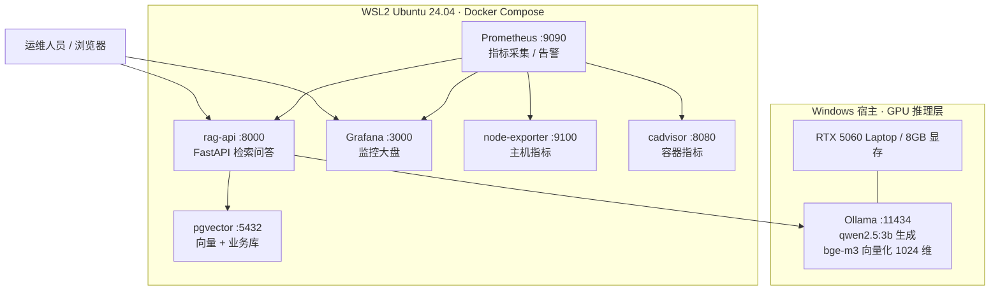
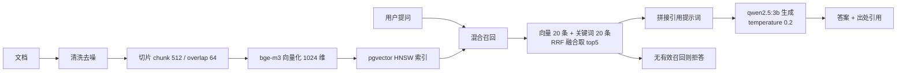
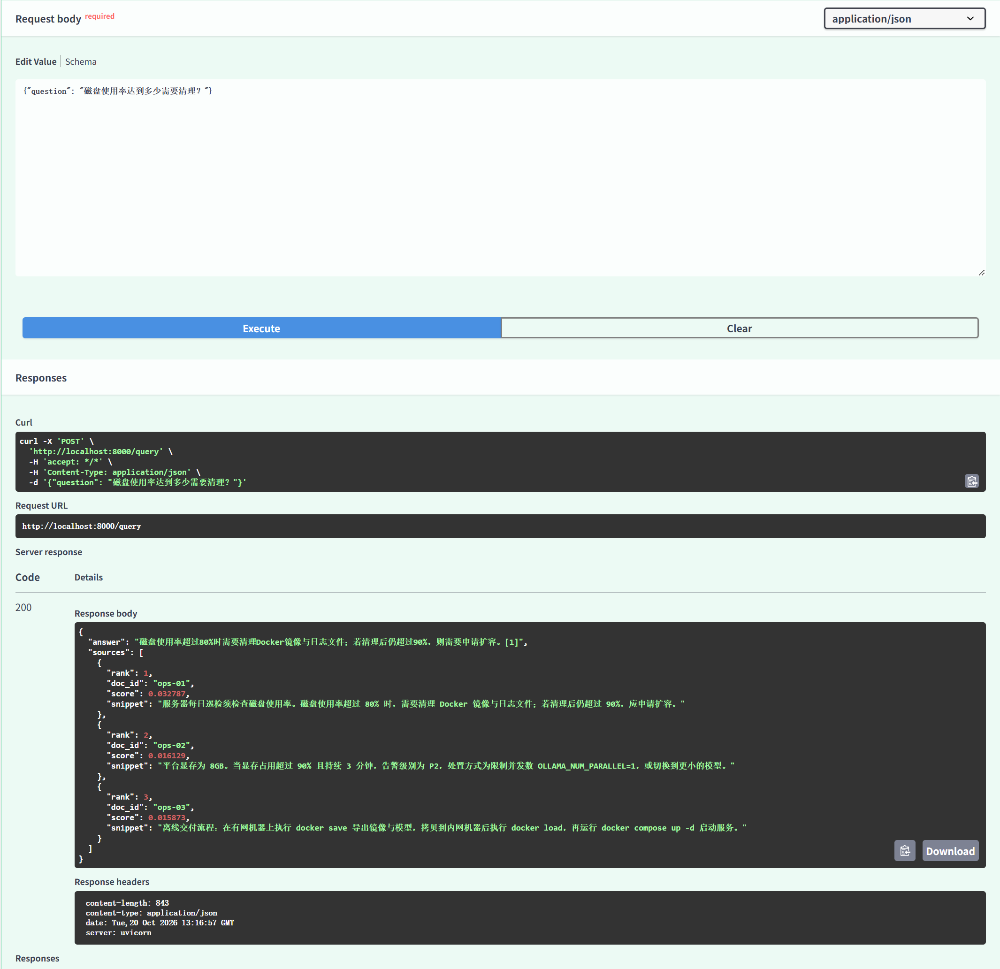

# aiops-platform｜私有化 AI 知识库运维平台

一套可在**离线/内网环境**交付的 AI 知识库平台：向量检索 + 本地大模型 + 监控告警 + 巡检备份，全部用 Docker Compose 编排，一条命令拉起。

> 面向场景：政务 / 公安 / 企业内网等**不能访问外网**、数据不允许出机的知识库问答。

---

## 架构



**检索链路**



> **为什么用 RRF 而不直接比分数**：向量相似度和关键词得分不在同一量纲，无法直接相加或比较。
> RRF 只用排名（`Σ 1/(k+rank)`，k 取 60），天然规避归一化问题，也不需要给两路召回调权重。


---

## 目录结构

```
aiops-platform/
├── docker-compose.yml        # 6 个服务的编排定义
├── .env.example              # 配置模板（复制为 .env）
├── Makefile                  # 常用操作入口
├── db/init.sql               # 建库建表建索引（首次启动自动执行）
├── rag-api/
│   ├── Dockerfile            # 非 root 运行 + 内置 HEALTHCHECK
│   ├── requirements.txt
│   └── main.py               # /ingest /query /health /metrics
├── prometheus/
│   ├── prometheus.yml        # 4 个抓取目标
│   └── alerts.yml            # 6 条分级告警规则
├── scripts/
│   ├── health_check.sh       # 8 项巡检，异常以 [FAIL] 标出
│   ├── backup.sh             # dump + 配置打包 + 保留 7 份
│   ├── ingest_dir.sh         # 批量入库整个目录
│   ├── bootstrap-ubuntu.sh   # 阶段3：WSL 内装 Docker（阿里云源 + 强制 IPv4）
│   ├── bootstrap-start.sh    # 阶段4：配镜像加速 + 起 pgvector/rag-api
│   ├── fix-wsl-net.sh        # 阶段5：修复 host-gateway 解析错误
│   ├── diag-net.sh           # 网络诊断（A~E 五段，定位容器→宿主链路）
│   └── start-windows.ps1     # Windows 日常启停（WSL 常驻 + 端口转发 + 健康检查）
├── docs/
│   ├── 部署实录-2026-10-20.md  # ★ 从零到跑通的完整过程（含 6 个坑）
│   ├── 检索测试记录.md         # 三类问答的实测结果
│   ├── 部署手册.md
│   ├── 巡检表.md
│   ├── 故障演练记录.md
│   └── 离线交付包清单.md
└── data/                     # 运行期数据（不入库）
```

---

## 从零部署（换机器 / 重装必看）

> **先读 [`docs/部署实录-2026-10-20.md`](docs/部署实录-2026-10-20.md)**
>
> 那是按实际执行顺序写的完整过程，包含 6 个必踩的坑：
> `apt` 因 IPv6 卡死、`wsl --import` 父目录不存在、`.wslconfig` 中文注释报错、
> `host-gateway` 在 WSL2 解析成 172.17.0.1、WSL 端口转发对 Docker 无效、WSL VM 随会话退出而关机。
>
> 下面的「快速开始」是已经在 Linux 环境里时的简版。

## 快速开始

### 1. 前置：Ollama（宿主机）

```bash
# 必须监听 0.0.0.0，否则容器无法访问
# Windows: 设置环境变量 OLLAMA_HOST=0.0.0.0:11434 后重启 Ollama
ollama pull qwen3:4b
ollama pull bge-m3
```

验证容器能否访问宿主机：

```bash
docker run --rm --add-host=host.docker.internal:host-gateway curlimages/curl:latest \
  -s http://host.docker.internal:11434/api/tags
```

### 2. 启动

```bash
cp .env.example .env
docker compose up -d
docker compose ps
```

### 3. 验证

```bash
curl -s localhost:8000/health | python3 -m json.tool
# {"db": "up", "ollama": "up", "chunks": 0, ...}
```

### 4. 入库与提问

```bash
curl -X POST localhost:8000/ingest -H 'Content-Type: application/json' \
  -d '{"doc_id":"ops-manual-01","text":"服务器巡检每日检查磁盘使用率，超过 80% 需清理镜像与日志。","meta":{"source":"manual"}}'

curl -X POST localhost:8000/query -H 'Content-Type: application/json' \
  -d '{"question":"磁盘到多少要处理？"}'
```

### 5. 打开监控

| 服务 | 地址 | 账号 |
|---|---|---|
| RAG 接口文档 | http://localhost:8000/docs | - |
| Prometheus | http://localhost:9090 | - |
| Grafana | http://localhost:3000 | admin / admin123 |

Grafana 导入现成看板：`Dashboards → Import`

- `1860` Node Exporter Full（主机）
- `14282` Cadvisor（容器）
- 自建一块 `RAG 服务` 面板：`rate(rag_query_total[5m])`、`histogram_quantile(0.95, ...)`

---

## 接口

| 方法 | 路径 | 说明 |
|---|---|---|
| POST | `/ingest` | 切片入库，同 `doc_id` 幂等覆盖 |
| POST | `/query` | 检索问答，返回 `answer` + `sources[]` |
| GET | `/healthz` | 存活探针（供 Docker healthcheck） |
| GET | `/health` | 依赖详情：DB / Ollama / 切片数 |
| GET | `/stats` | 切片数、文档数、当前参数 |
| GET | `/metrics` | Prometheus 指标 |

**自定义指标**：`rag_query_total{status}`、`rag_query_latency_seconds`、`rag_chunks_ingested_total`、`rag_retrieved_chunks`、`rag_embed_latency_seconds`、`rag_llm_latency_seconds`。

---

## 运维

```bash
make health      # 8 项巡检
make backup      # 备份（保留 7 份）
make logs        # 跟踪服务日志
make test        # 4 项冒烟测试
```

**巡检结果示例**（正常状态）：

```
[1] 容器状态        [ OK ] 无 unhealthy 容器
[2] 关键服务端口    [ OK ] 端口 8000 可连接
[3] 磁盘            [ OK ] 根分区使用率 43%
[4] 内存            [ OK ] 可用内存 5210MB / 15360MB (34%)
[5] 业务接口        [ OK ] RAG 服务 DB 正常
[8] 备份            [ OK ] 最近备份 3 小时前
 通过 12 项，异常 0 项
```

---

## 效果截图

### 1. 问答返回（含引用出处）

`POST /query` 返回答案与 3 条来源，每条带 `doc_id`、相关度分数、原文片段：



### 2. 检索质量验证

| 用例类型 | 问题 | 结果 |
|---|---|---|
| 事实型 | 磁盘使用率达到多少需要清理？ | ✅ rank1 命中目标文档（score 0.0328） |
| **边界型** | 公司今年的营收是多少？ | ✅ 返回「根据现有资料无法回答」 |
| 流程型 | 离线交付的完整流程是什么？ | ✅ 步骤完整，带 `[1]` 引用 |
| 专业型 | WSL2 里容器访问宿主机服务为什么会失败？ | ✅ 准确指出 host-gateway 解析错误与 refused/timeout 区别 |

完整测试数据见 [`docs/检索测试记录.md`](docs/检索测试记录.md)。

### 3. 监控大盘

> 待补充：Prometheus + Grafana 面板截图（主机资源、容器资源、RAG 业务指标三块）

---

## 已验证的故障场景

| 场景 | 现象 | 处置 |
|---|---|---|
| 显存打满 | 请求排队、P95 涨到 20s+ | 限并发 `OLLAMA_NUM_PARALLEL=1`，降级小模型 |
| 容器被杀 | `ServiceDown` 1 分钟触发 | `restart: always` 自动拉起，验证恢复时间 |
| 磁盘写满 | pgvector 写入失败，接口 500 | 清理镜像与日志，配置 `max-size` 轮转 |
| 断外网 | 无法拉镜像、无法下模型 | 离线交付包 `docker load` + 本地 GGUF |
| 误删数据 | 检索返回空 | `pg_restore` 回滚，验证命中恢复 |
| **模型静默返回空答案** | HTTP 200，但 `response` 为空字符串 | 排查 `done_reason` 是否为 `length`，检查模型模板是否硬编码思考标签 |
| **WSL2 容器连不上宿主机** | `Connection refused`（非 timeout） | 查容器 `/etc/hosts` 的 `host.docker.internal` 是否指向 `172.17.0.1`，改用真实网关 IP |

详见 [`docs/故障演练记录.md`](docs/故障演练记录.md) 与 [`docs/部署实录-2026-10-20.md`](docs/部署实录-2026-10-20.md)。

---

## 说明与边界

- 单机部署，未做多节点与高可用；数据量为百万字级，未做千万级压测。
- 检索为「向量 + 三元组关键词」混合，未接入 cross-encoder 重排序（可扩展 `bge-reranker`）。
- 模型为量化版本，生成质量与显存强相关，生产环境应按业务 SLA 选择模型规格。
